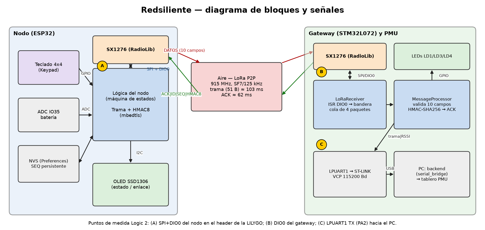

# Redsiliente — red LoRa de reporte de daños (proyecto final)

Proyecto final de Estructuras Computacionales. Red de nodos reportadores de campo
que envían reportes de daño por **LoRa P2P (915 MHz)** a un gateway, el cual los
reenvía por puerto serie a un tablero offline-first del PMU, pensado para
emergencias sin señal celular.

> **Repositorio de referencia:** [OMANROQUI/Redsiliente](https://github.com/OMANROQUI/Redsiliente)
> (código completo: firmware, backend y tablero). Este documento se centra en la
> parte de hardware y organización del computador que pide el curso.

## Hardware

| Rol | Placa | MCU | Radio |
|---|---|---|---|
| Nodo emisor (x2) | LILYGO TTGO LoRa32 T3_V1.6.1 | ESP32 | SX1276 |
| Gateway receptor | ST B-L072Z-LRWAN1 (módulo Murata CMWX1ZZABZ) | STM32L072CZ | SX1276 |

---

## 1. Diagrama de conexión

<!-- TODO: esquema de cableado de cada placa (nodo + teclado 4x4 + OLED + antena; gateway + USB ST-LINK). -->

## 2. Diagrama de bloques y señales (Logic 2)

<!-- TODO: diagrama de bloques del sistema y capturas del analizador lógico (Saleae Logic 2): SPI MCU <-> SX1276, DIO0, UART al PC. -->

| Señal capturada | Canal | Qué se observa | Medida |
|---|---|---|---|
| | | | |

## 3. Máquina de estados

<!-- TODO: dibujo de la máquina de estados del nodo (reposo, lectura de teclado, TX, espera de ACK, reintento) y del gateway. -->

| Estado | Evento / condición | Siguiente estado | Acción |
|---|---|---|---|
| | | | |

## 4. Pines y su función

### Nodo (ESP32)

| Pin | Periférico | Función |
|---|---|---|
| | | |

### Gateway (STM32L072)

| Pin | Periférico | Función |
|---|---|---|
| | | |

## 5. Representación con el SX1276 (hoja de datos)

<!-- TODO: relación entre los registros / pines del SX1276 (SPI, NSS, RESET, DIO0, conmutador RF) y la configuración usada. -->

| Parámetro | Valor | Registro / sección de la hoja de datos |
|---|---|---|
| | | |

## 6. Periféricos y tipo de puertos

<!-- TODO: SPI, UART, GPIO, I2C (OLED), analógicos, etc. -->

| Periférico | Placa | Tipo de puerto | Uso en el sistema |
|---|---|---|---|
| | | | |

## 7. Librerías del sistema y cómo se usan

<!-- TODO: cómo se usan RadioLib, Keypad, Adafruit SSD1306/GFX y el core STM32duino. -->

| Librería | Dónde | Para qué |
|---|---|---|
| | | |

## 8. Qué se necesita

<!-- TODO: materiales, herramientas (PlatformIO, ST-LINK, Logic 2) y requisitos. -->

## 9. Resultados de la depuración

<!-- TODO: resultados claros de la depuración: logs del monitor serie, RSSI, ACKs, errores encontrados y cómo se corrigieron. -->

| Prueba | Resultado esperado | Resultado obtenido | Evidencia |
|---|---|---|---|
| | | | |
