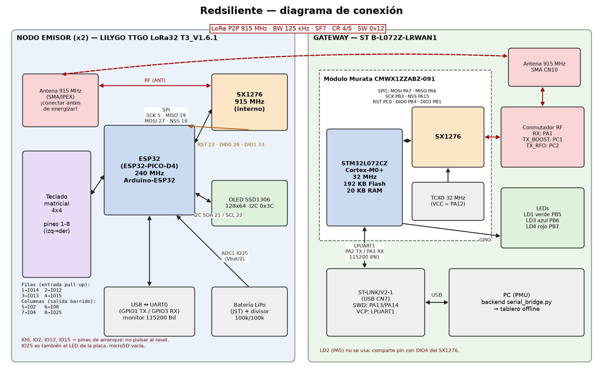
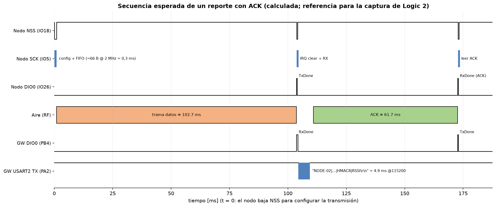
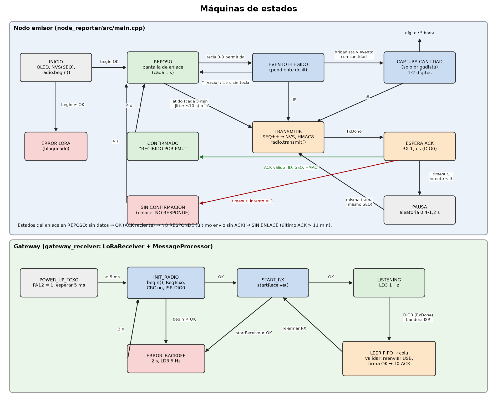

# Redsiliente — red LoRa de reporte de daños (proyecto final)

Proyecto final de Estructuras Computacionales. Red de nodos reportadores de campo
que envían reportes de daño por **LoRa P2P (915 MHz)** a un gateway, el cual los
reenvía por puerto serie a un tablero offline-first del PMU, pensado para
emergencias sin señal celular.

> **Repositorio de referencia:** [OMANROQUI/Redsiliente](https://github.com/OMANROQUI/Redsiliente)
> (código completo: firmware, backend y tablero). Este documento se centra en la
> parte de hardware y organización del computador que pide el curso. Los pines,
> registros y tiempos se tomaron del firmware de ese repositorio
> (`firmware/node_reporter` y `firmware/gateway_receiver`).

## Hardware

| Rol | Placa | MCU | Radio |
|---|---|---|---|
| Nodo emisor (x2) | LILYGO TTGO LoRa32 T3_V1.6.1 | ESP32 | SX1276 |
| Gateway receptor | ST B-L072Z-LRWAN1 (módulo Murata CMWX1ZZABZ) | STM32L072CZ | SX1276 |

Las figuras de este documento se generan con [`tools/generar_figuras.py`](tools/generar_figuras.py)
(`python tools/generar_figuras.py`, necesita `matplotlib`). El mismo script calcula el
tiempo en el aire de las tramas LoRa que se usa en las secciones 2 y 5.

**Firmware de la guía STM32 (reloj, PWM, CLI):** la sección 10 y
[`firmware/gateway_cli_pwm`](firmware/gateway_cli_pwm/) cubren la guía *"STM32, PWM,
CLI y código limpio"* sobre la placa del gateway.

---

## 1. Diagrama de conexión



**Nodo (LILYGO T3_V1.6.1).** El SX1276, la pantalla OLED y el divisor de batería ya
vienen soldados en la placa; lo único que se cablea por fuera es el **teclado matricial
4x4** (8 hilos, sin GND ni 3,3 V) y la **antena de 915 MHz**. El USB de la placa sirve
para cargar el firmware y para el monitor serie.

| Pin del teclado (izq → der) | Función | Pin ESP32 |
|---|---|---|
| 1 | Fila 1 (`1 2 3 A`) | IO14 |
| 2 | Fila 2 (`4 5 6 B`) | IO12 |
| 3 | Fila 3 (`7 8 9 C`) | IO13 |
| 4 | Fila 4 (`* 0 # D`) | IO15 |
| 5 | Columna 1 | IO2 |
| 6 | Columna 2 | IO0 |
| 7 | Columna 3 | IO4 |
| 8 | Columna 4 | IO25 |

**Gateway (B-L072Z-LRWAN1).** No lleva cableado externo: el STM32L072 y el SX1276
están dentro del módulo Murata y se comunican por líneas internas. Se conecta la antena
al SMA **CN10** y el micro-USB **CN7** (ST-LINK) al PC del PMU; por ese mismo cable se
carga el firmware (SWD) y se reciben las tramas (puerto COM virtual del LPUART1).

Precauciones:
- Enroscar la antena **antes** de energizar cualquier placa (transmitir sin carga puede dañar el PA del SX1276).
- IO0, IO2, IO12 e IO15 son pines de arranque del ESP32: no pulsar teclas al encender, reiniciar o cargar firmware.
- La ranura microSD de la LILYGO debe quedar vacía: comparte IO2, IO13, IO14 e IO15 con el teclado.

## 2. Diagrama de bloques y señales (Logic 2)


Flujo de un reporte:
1. La persona elige el evento en el **teclado** (GPIO) y confirma con `#`.
2. El ESP32 arma la trama de 10 campos, la firma con HMAC-SHA256 y la escribe en el FIFO del **SX1276 por SPI**.
3. El SX1276 la transmite; al terminar levanta **DIO0 = TxDone** y el nodo pasa a recepción durante 1,5 s.
4. En el gateway, el SX1276 levanta **DIO0 = RxDone**; la ISR solo marca una bandera y el `loop()` lee el FIFO por SPI.
5. El STM32 valida la trama y la reenvía por **LPUART1 → ST-LINK → USB** al PC, añadiendo el RSSI.
6. Si la firma es correcta, el gateway responde por radio con `ACK|DEVICE_ID|SEQ|HMAC8`, y el nodo muestra `RECIBIDO POR PMU`.

### Secuencia esperada (referencia para la captura)



La figura anterior **es calculada, no medida**: muestra lo que debe verse en el
analizador con los parámetros del firmware (SF7, BW 125 kHz, CR 4/5, preámbulo de 8
símbolos, cabecera explícita y CRC). Sirve para comprobar la captura real.

### Captura con Saleae Logic 2

<!-- Pendiente: exportar la captura real de Logic 2 como img/logic2-captura.png y enlazarla aquí. -->

Montaje sugerido (punto **A** del diagrama de bloques, en el header de la LILYGO;
puntos **B** y **C** en la B-L072Z):

| Canal | Señal | Analizador de Logic 2 |
|---|---|---|
| D0 | NSS nodo (IO18) | SPI — Enable, activo bajo |
| D1 | SCK nodo (IO5) | SPI — Clock, CPOL 0 / CPHA 0 |
| D2 | MOSI nodo (IO27) | SPI — MOSI, MSB primero, 8 bits |
| D3 | MISO nodo (IO19) | SPI — MISO |
| D4 | DIO0 nodo (IO26) | — (flanco de subida = TxDone / RxDone) |
| D5 | LPUART1 TX gateway (PA2) | Async Serial, 115200, 8N1 |
| GND | GND común de las placas | — |

Frecuencia de muestreo: ≥ 16 MS/s (SPI a 2 MHz). Disparo: flanco de bajada en D0.

| Señal capturada | Canal | Qué se observa | Valor esperado (calculado) | Medida |
|---|---|---|---|---|
| Ráfaga SPI de configuración + FIFO | D0–D3 | Escrituras con bit 7 de la dirección en 1 (`0x80 \| reg`); `0x80` = escritura en `RegFifo` seguida de los 51 bytes ASCII de la trama | SCK = 2 MHz; 52 B ≈ 0,21 ms | por medir |
| Lectura de `RegVersion` (0x42) al arrancar | D0–D3 | MOSI `0x42`, MISO `0x12` (versión del SX1276; RadioLib la comprueba en `begin()`) | `0x12` | por medir |
| TxDone del nodo | D4 | Pulso de DIO0 tras el envío; el ancho de la trama en el aire es el tiempo entre el comando TX (`RegOpMode = 0x83`) y este flanco | ToA de 51 B ≈ **102,7 ms** | por medir |
| Línea serie al PC | D5 | `NODE-02\|14\|2\|...\|60da5124\|-84\r\n` en ASCII | 57 caracteres ≈ **4,9 ms** a 115200 | por medir |
| RxDone del ACK en el nodo | D4 | Segundo pulso de DIO0, ≈ 60–70 ms después del TxDone | ToA del ACK (23 B) ≈ **61,7 ms** | por medir |
| Lectura del ACK | D0–D3 | `RegIrqFlags` (0x12), `RegRxNbBytes` (0x13) y lectura del FIFO (`0x00`) | 23 B + dirección | por medir |

> La columna **Medida** queda para los valores de la captura real con las placas
> (exportar la captura de Logic 2 como `img/logic2-captura.png`).

## 3. Máquina de estados



### Nodo emisor

| Estado | Evento / condición | Siguiente estado | Acción |
|---|---|---|---|
| INICIO | `radio.begin()` OK | REPOSO | Lee `SEQ` de la NVS, muestra nodo y rol en la OLED, programa el primer latido (3–13 s) |
| INICIO | `radio.begin()` falla | ERROR LORA | Muestra `ERROR LORA`, queda bloqueado |
| REPOSO | Tecla `0`–`9` permitida para el rol | EVENTO ELEGIDO | Guarda el evento y muestra `# = ENVIAR` |
| REPOSO | Tecla `5` (o `6` en el líder) | REPOSO | Muestra `EVENTO AUTOMATICO` / `NO DISPONIBLE` |
| REPOSO | Vence el temporizador del latido (5 min + hasta 10 s aleatorios) o `h` por Serial | TRANSMITIR | Trama con `EVENT_CODE = H` y `QTY = 0` |
| REPOSO | Cada 1 s | REPOSO | Redibuja el estado del enlace: `sin datos`, `PMU OK`, `NO RESPONDE`, `SIN ENLACE` |
| EVENTO ELEGIDO | Brigadista y el evento usa cantidad | CAPTURA CANTIDAD | Pide la cantidad (`0=parcial 1=total` en `VIA_BLOQUEADA`) |
| EVENTO ELEGIDO | `#` | TRANSMITIR | `QTY = 0` |
| EVENTO ELEGIDO | `*` o 15 s sin teclas | REPOSO | Cancela y muestra `CANCELADO` |
| CAPTURA CANTIDAD | Dígito (máx. 2, o 1 en `VIA_BLOQUEADA`) / `*` | CAPTURA CANTIDAD | Agrega o borra un dígito; renueva el plazo de 15 s |
| CAPTURA CANTIDAD | `#` | TRANSMITIR | `QTY` = valor tecleado (0 si está vacío) |
| TRANSMITIR | — | ESPERA ACK | `SEQ++` y se guarda en NVS **antes** de transmitir; calcula `HMAC8`; `radio.transmit()` |
| ESPERA ACK | Llega `ACK\|NODE-xx\|SEQ\|HMAC8` válido en ≤ 1,5 s | CONFIRMADO | Guarda RSSI y hora del ACK |
| ESPERA ACK | Llega otro paquete (otro nodo, otro SEQ, firma mala) | ESPERA ACK | Lo ignora y sigue escuchando |
| ESPERA ACK | 1,5 s sin ACK, intento < 3 | PAUSA | Espera aleatoria de 0,4–1,2 s |
| PAUSA | Fin de la pausa | TRANSMITIR | Retransmite **la misma trama** (mismo `SEQ` y firma) |
| ESPERA ACK | 1,5 s sin ACK, intento = 3 | SIN CONFIRMACIÓN | Muestra `SIN CONFIRMACION`; enlace = `NO RESPONDE` |
| CONFIRMADO / SIN CONFIRMACIÓN | 4 s (`UI_HOLD_MS`) | REPOSO | Vuelve la pantalla de estado |

### Gateway

| Estado | Evento / condición | Siguiente estado | Acción |
|---|---|---|---|
| POWER_UP_TCXO | Pasan 5 ms desde `PA12 = 1` | INIT_RADIO | — |
| INIT_RADIO | `begin()` OK | START_RX | Escribe `RegTcxo`, activa CRC, enlaza la ISR de DIO0 |
| INIT_RADIO | `begin()` falla | ERROR_BACKOFF | Log `# [LoRa] ERROR`, LD3 a 5 Hz |
| START_RX | `startReceive()` OK | LISTENING | Modo RX continuo, LD3 a 1 Hz |
| START_RX | `startReceive()` falla | ERROR_BACKOFF | — |
| LISTENING | ISR de DIO0 (RxDone) levanta la bandera | START_RX | Lee el FIFO a la cola circular de 4 paquetes (si está llena descarta el más viejo) |
| ERROR_BACKOFF | Pasan 2 s | INIT_RADIO | `radioRestarts++` |
| (`loop`) | Paquete en la cola | — | Valida los 10 campos → reenvía `trama\|RSSI` por USB → si la firma es correcta, transmite el ACK (~60 ms) y vuelve a RX |
| (`loop`) | Nodo sin tramas > 11 min | — | Lo marca `OFFLINE` en el log |

El `loop()` del gateway es cooperativo y **no usa `delay()`**: cada módulo
(`LoRaReceiver`, `MessageProcessor`, `StatusLed`) avanza un paso y devuelve el control.
La ISR no toca SPI ni Serial; solo escribe una variable `volatile`.

## 4. Pines y su función

### Nodo (ESP32)

| Pin | Periférico | Función |
|---|---|---|
| IO5 | VSPI SCK | Reloj SPI hacia el SX1276 |
| IO19 | VSPI MISO | Datos SX1276 → ESP32 |
| IO27 | VSPI MOSI | Datos ESP32 → SX1276 |
| IO18 | GPIO (NSS) | Chip select del SX1276 (activo bajo) |
| IO23 | GPIO | RESET del SX1276 |
| IO26 | GPIO entrada | DIO0 del SX1276: TxDone / RxDone (se lee en la espera del ACK) |
| IO33 | GPIO entrada | DIO1 del SX1276 (RxTimeout; lo usa RadioLib) |
| IO21 | I2C SDA | Pantalla OLED SSD1306 (dirección 0x3C) |
| IO22 | I2C SCL | Pantalla OLED SSD1306 |
| IO35 | ADC1_CH7 | Voltaje de batería a través del divisor 100k/100k (`mV × 2`) |
| IO14, IO12, IO13, IO15 | GPIO entrada con pull-up | Filas 1–4 del teclado |
| IO2, IO0, IO4, IO25 | GPIO salida | Columnas 1–4 del teclado (barrido). IO25 es también el LED de la placa |
| IO1 / IO3 | UART0 TX / RX | Monitor serie a 115200 por el USB de la placa (logs y pruebas `0`–`9`, `h`) |

### Gateway (STM32L072)

| Pin | Periférico | Función |
|---|---|---|
| PA7 | SPI1 MOSI | Datos STM32 → SX1276 (interno al módulo Murata) |
| PA6 | SPI1 MISO | Datos SX1276 → STM32 |
| PB3 | SPI1 SCK | Reloj SPI, 2 MHz, modo 0 |
| PA15 | GPIO (NSS) | Chip select del SX1276 |
| PC0 | GPIO | RESET del SX1276 (activo bajo) |
| PB4 | EXTI4 | DIO0: interrupción RxDone / TxDone |
| PB1 | GPIO entrada | DIO1 (RxTimeout) |
| PA12 | GPIO salida | Alimentación del TCXO de 32 MHz (JP9 en 1-2) |
| PA1 | GPIO salida | Conmutador de antena: camino RX |
| PC1 | GPIO salida | Conmutador de antena: TX por PA_BOOST |
| PC2 | GPIO salida | Conmutador de antena: TX por RFO |
| PA2 / PA3 | LPUART1 TX / RX (AF6) | Puerto COM virtual del ST-LINK, 115200 8N1 → PC |
| PB5 | GPIO salida | LD1 verde: pulso de 40 ms por trama válida reenviada |
| PB6 | GPIO salida | LD3 azul: 1 Hz escuchando, 5 Hz en error de radio |
| PB7 | GPIO salida | LD4 rojo: 200 ms por CRC erróneo o trama rechazada |
| PA13 / PA14 | SWD (SWDIO / SWCLK) | Programación y depuración por el ST-LINK |
| PA5 | — | **No se usa**: LD2 comparte pin con DIO4 del SX1276 |

## 5. Representación con el SX1276 (hoja de datos)

El SX1276 es un transceptor controlado **solo por registros**: el microcontrolador
escribe y lee registros de 8 bits por SPI (modo 0, MSB primero, máx. 10 MHz). El primer
byte de cada transacción es la dirección: **bit 7 = 1 escribe, bit 7 = 0 lee**; luego vienen
los datos y, con NSS en bajo, la dirección se autoincrementa (acceso en ráfaga), salvo en
`RegFifo` (0x00), donde cada byte entra o sale del FIFO de 256 bytes.

Pines del chip usados (sec. 2 y 4.1 de la hoja de datos):

| Pin SX1276 | Nodo (ESP32) | Gateway (STM32) | Uso |
|---|---|---|---|
| SCK, MOSI, MISO | IO5, IO27, IO19 | PB3, PA7, PA6 | Interfaz SPI de registros |
| NSS | IO18 | PA15 | Selección del chip |
| RESET | IO23 | PC0 | Reinicio por hardware al arrancar |
| DIO0 | IO26 | PB4 (EXTI) | Mapeado a RxDone en RX y TxDone en TX (`RegDioMapping1` bits 7-6 = `00` / `01`) |
| DIO1 | IO33 | PB1 | RxTimeout |
| PA_BOOST / RFO | conmutador interno de la LILYGO | PC1 / PC2 + PA1 (RX) | Camino de antena; en la B-L072Z lo maneja el firmware con la tabla RF de RadioLib |
| XTA (TCXO) | cristal de la placa | TCXO 32 MHz alimentado por PA12 | Referencia de frecuencia (`RegTcxo` bit 4 = 1 en el gateway) |

Configuración usada y su traducción a registros (valores según las fórmulas y tablas
de la hoja de datos; los escribe RadioLib en `begin()`):

| Parámetro | Valor | Registro / sección de la hoja de datos |
|---|---|---|
| Modo LoRa | `LongRangeMode = 1` | `RegOpMode` (0x01): `0x80` sleep, `0x81` standby, `0x83` TX, `0x85` RX continuo (sec. 4.1.4) |
| Frecuencia | 915,0 MHz | `RegFrf` (0x06–0x08) = 915·10⁶ / (32·10⁶ / 2¹⁹) = 14 991 360 = **`0xE4C000`** (sec. 4.1.4, F_STEP = 61,035 Hz) |
| Ancho de banda | 125 kHz | `RegModemConfig1` (0x1D) bits 7-4 = `0111` |
| Coding rate | 4/5 | `RegModemConfig1` bits 3-1 = `001`; bit 0 = 0 (cabecera explícita) → `RegModemConfig1 = 0x72` |
| Spreading factor | SF7 (128 chips/símbolo) | `RegModemConfig2` (0x1E) bits 7-4 = `0111`; bit 2 `RxPayloadCrcOn = 1` → `0x74` |
| Optimización baja tasa | desactivada | `RegModemConfig3` (0x26) bit 3 = 0 (T_sym = 2⁷/125 kHz = 1,024 ms < 16 ms); bit 2 `AgcAutoOn = 1` → `0x04` |
| Sync word | `0x12` (red privada; `0x34` es LoRaWAN) | `RegSyncWord` (0x39) |
| Preámbulo | 8 símbolos | `RegPreambleMsb/Lsb` (0x20–0x21) = `0x0008` (+4,25 símbolos fijos) |
| Potencia TX | 14 dBm (20 en campo) | `RegPaConfig` (0x09): `PaSelect = 1` (PA_BOOST), P_out = 17 − (15 − OutputPower) → OutputPower = 12; para 20 dBm además `RegPaDac` (0x4D) = `0x87` (sec. 5.4) |
| LNA | AGC automático | `RegLna` (0x0C) + `AgcAutoOn` |
| Versión del chip | `0x12` | `RegVersion` (0x42), se verifica al iniciar |
| Fin de TX / RX | interrupción | `RegIrqFlags` (0x12): bit 6 RxDone, bit 5 PayloadCrcError, bit 3 TxDone; se limpian escribiendo 1 |
| Lectura del paquete | — | `RegRxNbBytes` (0x13) da la longitud y `RegFifoRxCurrentAddr` (0x10) la posición; se copia a `RegFifoAddrPtr` (0x0D) y se lee `RegFifo` (0x00) |
| RSSI del paquete | dBm | `RegPktRssiValue` (0x1A): RSSI = −157 + valor (puerto de alta frecuencia); SNR en `RegPktSnrValue` (0x19) / 4 |
| TCXO (solo gateway) | entrada XTA desde TCXO | `RegTcxo` (0x4B) bit 4 `TcxoInputOn = 1`, escrito en sleep (`lora_receiver.cpp`) |

Tiempo en el aire (sec. 4.1.1.7, calculado por `tools/generar_figuras.py`):

```
T_sym     = 2^SF / BW = 128 / 125 kHz = 1,024 ms
T_preamb  = (8 + 4,25) · T_sym = 12,54 ms
N_payload = 8 + ceil((8·PL − 4·SF + 28 + 16·CRC) / (4·SF)) · (CR + 4)
Trama del nodo (PL = 51 B): N = 88 símbolos → ToA ≈ 102,7 ms
ACK del gateway (PL = 23 B): N = 48 símbolos → ToA ≈  61,7 ms
Máximo del FIFO (PL = 255 B):                 ToA ≈ 399,6 ms
```

## 6. Periféricos y tipo de puertos

| Periférico | Placa | Tipo de puerto | Uso en el sistema |
|---|---|---|---|
| SPI (VSPI) | Nodo | Serie síncrono, full dúplex, 4 hilos, 2 MHz modo 0 | Registros y FIFO del SX1276 |
| SPI1 | Gateway | Serie síncrono, 4 hilos, 2 MHz modo 0 (interno al módulo) | Registros y FIFO del SX1276 |
| I2C | Nodo | Serie síncrono, 2 hilos, maestro, dirección 0x3C | Pantalla OLED SSD1306 128x64 |
| UART0 | Nodo | Serie asíncrono 115200 8N1 por el puente USB de la placa | Carga de firmware, logs, disparo de pruebas |
| LPUART1 | Gateway | Serie asíncrono 115200 8N1 → VCP del ST-LINK (USB) | Salida de tramas `...\|RSSI` hacia el backend |
| GPIO digital (matriz) | Nodo | 4 entradas con pull-up + 4 salidas de barrido | Teclado 4x4 (antirrebote 30 ms) |
| GPIO digital | Ambos | Salida | NSS y RESET del SX1276; conmutador de antena y TCXO (gateway) |
| Interrupción externa (EXTI) | Gateway | Entrada digital, flanco de subida | DIO0 → ISR que levanta una bandera |
| Entrada digital (sondeo) | Nodo | Entrada | DIO0, leído en la ventana de 1,5 s del ACK |
| ADC (ADC1_CH7) | Nodo | Analógico, 12 bits, calibrado (`analogReadMilliVolts`) | Voltaje de batería (campo `BATT_MV`) |
| LEDs | Gateway | GPIO salida temporizada con `millis()` | LD1, LD3, LD4 de estado |
| NVS (flash) | Nodo | Memoria no volátil (Preferences) | `SEQ` persistente entre reinicios |
| SWD | Gateway | Depuración de 2 hilos (ST-LINK/V2-1) | Programación y depuración |
| Radio (RF) | Ambos | LoRa 915 MHz, semidúplex | Enlace nodo ↔ gateway |

## 7. Librerías del sistema y cómo se usan

| Librería | Dónde | Para qué |
|---|---|---|
| **RadioLib** 7.x (`jgromes/RadioLib`) | Nodo y gateway | Driver del SX1276: `begin(freq, bw, sf, cr, syncWord, power, preamble)`, `transmit()`, `startReceive()`, `readData()`, `getRSSI()`, `setPacketReceivedAction()` (ISR de DIO0) y `setRfSwitchTable()` (conmutador de antena del gateway) |
| **Keypad** 3.1.1 (`chris--a/Keypad`) | Nodo | Barrido de la matriz 4x4: `Keypad(makeKeymap(keyMap), rowPins, colPins, 4, 4)`, `getKey()` en cada `loop()`, `setDebounceTime(30)` |
| **Adafruit SSD1306** 2.5 + **Adafruit GFX** 1.11 | Nodo | `display.begin(SSD1306_SWITCHCAPVCC, 0x3C)` y dibujo de texto en un búfer de 128x64 que se envía por I2C con `display.display()` |
| **Wire** (core Arduino-ESP32) | Nodo | Bus I2C en IO21/IO22 para la OLED |
| **SPI** (core) | Ambos | `SPI.begin(5, 19, 27, 18)` en el nodo; `SPIClass(PA7, PA6, PB3)` en el gateway |
| **Preferences** (NVS del ESP32) | Nodo | `prefs.getUInt("seq")` al arrancar y `putUInt("seq")` antes de cada transmisión |
| **mbedTLS** (`mbedtls/md.h`, incluido en ESP-IDF) | Nodo | HMAC-SHA256 de la trama y del ACK esperado |
| `hmac_sha256.cpp` (propio) | Gateway | SHA-256 (FIPS 180-4) y HMAC (RFC 2104) sin dependencias, para no cargar mbedTLS en 192 KB de flash; verificado contra Python |
| **Core Arduino-ESP32** (`espressif32`, placa `ttgo-lora32-v21`) | Nodo | `setup()/loop()`, `millis()`, `analogReadMilliVolts()`, `esp_random()` (semilla de los retardos aleatorios) |
| **Core STM32duino** (`ststm32@20.0.0`, placa `disco_l072cz_lrwan1`) | Gateway | `Serial` sobre LPUART1, `attachInterrupt` (EXTI), `pinMode`, `millis()` |

En el gateway se excluyen de RadioLib los drivers que no se usan
(`-D RADIOLIB_EXCLUDE_SX126X`, `..._LORAWAN`, etc.) para que el firmware quepa con
holgura en el STM32L072.

## 8. Qué se necesita

**Materiales**
- 2 × LILYGO TTGO LoRa32 T3_V1.6.1 (variante de 915 MHz) con su antena.
- 1 × ST B-L072Z-LRWAN1 con su antena de 900 MHz.
- 2 × teclado matricial de membrana 4x4 y cables dupont hembra-macho (8 por teclado).
- Cables USB: micro-USB para la B-L072Z (CN7) y el de la LILYGO.
- Opcional: batería LiPo de 3,7 V con conector JST para operar los nodos sin USB.
- Analizador lógico compatible con **Saleae Logic 2** (8 canales) y puntas de prueba.
- PC del PMU (Windows o Linux).

**Software y herramientas**
- VS Code + **PlatformIO** (`pio`), que descarga los cores y las librerías de los `platformio.ini`.
- Controladores del **ST-LINK/V2-1** (carga por SWD y puerto COM virtual).
- **Saleae Logic 2** con los analizadores SPI y Async Serial.
- Python 3 con `uv` para el backend y `scripts/gateway_monitor.py` del repositorio de referencia.

**Pasos**
```bash
# Nodo líder (NODE-01) y nodo brigadista (NODE-02)
cd firmware/node_reporter
pio run -e nodo_01 -t upload --upload-port <puerto>
pio run -e nodo_02 -t upload --upload-port <puerto>

# Gateway
cd firmware/gateway_receiver
pio run -t upload            # por ST-LINK
pio device monitor -b 115200 # ver tramas y diagnóstico "# ..."
```

**Requisitos de configuración**
- Los dos firmwares deben tener los mismos parámetros de radio (915 MHz, 125 kHz, SF7, CR 4/5, sync word 0x12): si uno difiere, el receptor no ve nada y no hay mensaje de error.
- La llave `HMAC_SECRET` debe ser la misma en nodos, gateway y backend.
- El gateway solo acepta `DEVICE_ID` registrados en `src/node_registry.cpp`.
- Cerrar el monitor serie antes de cargar firmware (ocupa el puerto COM).

## 9. Resultados de la depuración

Resultados documentados en el historial y los README del repositorio de referencia,
obtenidos con las tres placas reales:

| Prueba | Resultado esperado | Resultado obtenido | Evidencia |
|---|---|---|---|
| Arranque de la radio del gateway | `# [LoRa] OK f=915.0 MHz BW=125.0 kHz SF=7 CR=4/5 SW=0x12`, LD3 a 1 Hz | Correcto, tras alimentar el TCXO por PA12 y escribir `RegTcxo` | `firmware/gateway_receiver/README.md` |
| Recepción de los dos nodos | Tramas `NODE-01` y `NODE-02` reenviadas por USB con `\|RSSI` | Correcto; el gateway marca cada nodo `ONLINE` | README del gateway, commit `1092fdb` |
| Cableado del teclado | Cada tecla produce su carácter | **Falló al principio**: el orden de pines supuesto no coincidía. Se escribió `tools/keytest.cpp`, que prueba los 28 pares de pines e imprime `[PAR] IOx <-> IOy`; con eso se corrigió el orden (filas IO14, 12, 13, 15; columnas IO2, 0, 4, 25) | commit `fbb98c1` |
| `SEQ` tras apagar el nodo | Sigue creciendo | **Falló al principio**: volvía a 0 y el backend descartaba reportes nuevos como duplicados. Se guardó en NVS antes de cada transmisión | commit `775c723` |
| ACK del PMU | El nodo muestra `RECIBIDO POR PMU` con el RSSI del ACK | Correcto, ACK validado por el nodo (ID, SEQ y firma) | commit `d6b5708` |
| Colisión de tramas | El nodo reintenta la misma trama y el backend descarta el duplicado | Correcto: retransmisión tras una colisión; el gateway cuenta `dup` | commit `d6b5708` |
| Firma alterada | Se reenvía al PC como no verificada y **sin** ACK | Correcto: `# [FIRMA] ... HMAC8 invalido, sin ACK`; el nodo hace 3 intentos y muestra `SIN CONFIRMACION` | commit `d6b5708` |
| PMU apagado | La pantalla del nodo indica falta de enlace en cuanto falla un envío | **Falló al principio**: mostraba `PMU OK` hasta 11 min después. Se añadió el estado `NO RESPONDE`; probado deteniendo la STM32 con `openocd halt`: `OK → NO RESPONDE → OK` | commit `3bff3b8` |
| HMAC-SHA256 propio del gateway | Igual al de mbedTLS / Python | Coincide en 1244 casos de prueba | commit `d6b5708` |
| Falsa recepción después de transmitir el ACK | El gateway no procesa un paquete inexistente | En TX, DIO0 significa TxDone y disparaba la ISR de RX; se limpia la bandera tras `transmit()` y antes se rescata un paquete pendiente | `lora_receiver.cpp`, `sendFrame()` |
| LED LD2 | — | No se usa: PA5 está conectado también a DIO4 del SX1276 | `lora_config.h` |

Errores conocidos y límites:
- Mientras el gateway transmite un ACK (≈ 62 ms) no escucha: una trama que llegue en ese momento se pierde y el nodo la reintenta.
- No hay GPS: la posición es siempre la de respaldo (`GPS_FIX = 0`) y `ACCEL_G` está simulado hasta integrar el MPU6050.
- Los dos nodos comparten la llave HMAC; sirve para la demostración, no para producción.
- El ejemplo `ACK|NODE-01|14|b8905636` del README del gateway no coincide con la llave de demo
  `REDSILIENTE_KEY_2026` (con esa llave el HMAC8 de `ACK|NODE-01|14` es `1dcf7874`); la trama de datos de ejemplo (`60da5124`) sí coincide.
- Las medidas de la sección 2 (Logic 2) están pendientes de la captura con el analizador.

## 10. Reloj, PWM, botón y CLI en el gateway (guía STM32)

El firmware [`firmware/gateway_cli_pwm`](firmware/gateway_cli_pwm/) usa la misma
B-L072Z-LRWAN1 del gateway para cumplir la guía *"STM32, PWM, CLI y código limpio"*. Es
un firmware aparte del receptor LoRa porque los dos ocupan el mismo puerto serie. Compila
con PlatformIO sin advertencias (RAM 9,9 %, Flash 23,4 %) y se verificó ejecutándolo en el
emulador Renode (ver abajo). Su README tiene el detalle;
aquí, dónde se cumple cada punto:

| Punto de la guía | Dónde | Resumen |
|---|---|---|
| 2. Entorno y hardware | README del firmware, sec. 1 | PWM en LD1 = PB5 = **TIM3_CH2** (verificado en el mapa de pines del core, no supuesto); LD2/PA5 descartado por DIO4; botón B1 = PB2 con nivel activo detectado |
| 3. Arquitectura | sec. 3 y `cli-arquitectura.png` | Módulos `system_clock`, `pwm`, `button`, `serial_line`, `cli`, `application`, `brightness`, `adc_monitor`, `radio_probe`; `loop()` sin `delay()` |
| 4. Reloj | sec. 4 | HSI16 × 4 / 2 = **32 MHz**; SYSCLK, HCLK, PCLK1/2 y reloj de timers leídos de RCC; MCO = 2 MHz en PA8 para medirlo |
| 5. Timer y PWM | sec. 5 | Ascendente, alineado al flanco, PWM modo 1, activo alto, preload; tabla de PSC/ARR/CCR y tiempos |
| 6. Fade perceptual | sec. 6 | Niveles 0–100 % con gamma 2.2 (2,9 / 13,3 / 32,5 / 61,2 %); `fade linear` vs `fade gamma` |
| 7. Botón | sec. 7 y `cli-boton-estados.png` | RELEASED / DEBOUNCE_PRESS / PRESSED / DEBOUNCE_RELEASE, 20 ms, un evento por pulsación |
| 8. Serial y CLI | sec. 2 y 8 | LPUART1 (PA2/PA3) → ST-LINK, 115200 8N1; línea con terminador, buffer de 64 con overflow; `help`, `status`, `frequency`, `duty`, `set frequency`, `set duty`, errores claros |
| 9. Clean code | todo el firmware | Nombres descriptivos, constantes con nombre, interfaces en `.h`, comentarios del *por qué*, validación de argumentos |
| 10. Periféricos extra | sec. 9 | ADC (VDDA y temperatura), SPI (lee `RegVersion` = 0x12 del SX1276), UART, MCO |
| 11. Validación | sec. 10 y 12 | Montaje para Logic 2 y 13 casos; **10 casos comprobados en simulación (Renode)** con la salida PWM medida en tiempo virtual |
| 12. Entregables | sec. 1–12 | Terminal y formas de onda **de la simulación**; no hay captura de Logic 2 sobre la placa |
| 13. Sustentación | sec. 11 | Respuestas cortas a las 11 preguntas |

Hallazgo al revisar el core: en esta placa el `Serial` de STM32duino es **LPUART1**
(`SERIAL_UART_INSTANCE 101`), no USART2; las secciones anteriores ya lo reflejan.

**Verificación en simulación.** El `.elf` se ejecutó en Renode 1.17.1 (STM32L072 emulado)
con los 13 casos de la guía; los resultados están en
[`firmware/gateway_cli_pwm/sim/resultados/`](firmware/gateway_cli_pwm/sim/resultados/). Medido
en el PB5 emulado: 500 Hz → periodo 2,0000 ms y 1,0000 ms en alto; 1 kHz al 25 % → 250,00 µs
en alto; niveles gamma 2,90 / 13,30 / 32,50 / 61,20 %; una pulsación con 3 rebotes → un
solo evento. Son resultados de simulación, no mediciones sobre la placa; el ADC, el SX1276
y el MCO no están modelados en el emulador.
