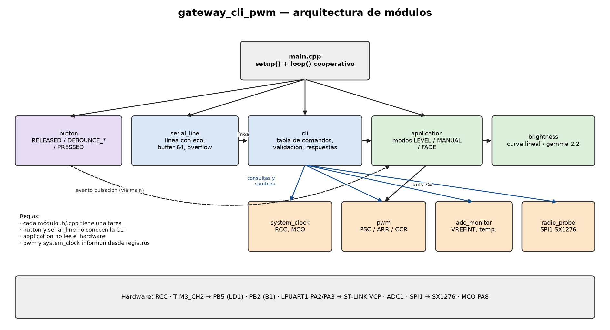
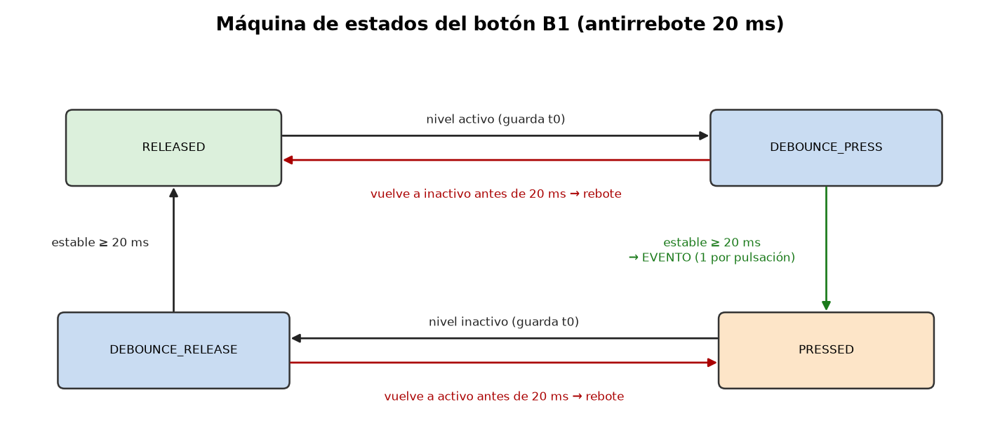

# gateway_cli_pwm — reloj, PWM, botón y CLI en el gateway

Firmware para la **B-L072Z-LRWAN1**, la misma placa del gateway LoRa de Redsiliente.
Cubre la guía del curso *"STM32, PWM, CLI y código limpio"*: configuración del reloj
y su comprobación, PWM por hardware, fade con corrección gamma, botón con máquina de
estados, CLI por el puerto serie del ST-LINK, y práctica de ADC y SPI (leyendo el
identificador del SX1276 del propio proyecto). Todo lo que informa la CLI sale de los
**registros** del microcontrolador, para poder contrastarlo con Logic 2.

> Es un firmware aparte del receptor LoRa (`firmware/gateway_receiver` en el
> [repositorio de referencia](https://github.com/OMANROQUI/Redsiliente)) porque los dos
> usan el mismo puerto serie: el receptor lo dedica a las tramas que lee el backend.

Compilado con PlatformIO (`platformio/ststm32@20.0.0`): RAM 2036 B (9,9 %),
Flash 46 000 B (23,4 %), sin advertencias con `-Wall`.

## 1. Conexiones y requisitos

| Señal | Pin STM32 | Conector Arduino | Periférico | Uso |
|---|---|---|---|---|
| PWM / LED LD1 (verde) | PB5 | D4 | TIM3_CH2 (AF4) | Salida PWM; el LED de la placa ya está en ese pin |
| Botón B1 USER | PB2 | D6 | GPIO entrada | Cambia el nivel de brillo |
| MCO | PA8 | D7 | RCC MCO (AF0) | SYSCLK / 16 = 2 MHz para medir el reloj |
| UART TX | PA2 | D1 | LPUART1 (AF6) | CLI → PC (ST-LINK VCP) |
| UART RX | PA3 | D0 | LPUART1 (AF6) | PC → CLI |
| SPI1 SCK / MISO / MOSI | PB3 / PA6 / PA7 | interno | SPI1 | SX1276 (dentro del módulo Murata) |
| NSS / RESET / TCXO | PA15 / PC0 / PA12 | interno | GPIO | Control del SX1276 |
| ADC | — | — | ADC1 canales internos | VREFINT y sensor de temperatura |

**PB5 sí tiene PWM por hardware**: el mapa de pines del core
(`PeripheralPins_B_L072Z_LRWAN1.c`) lo asigna a `TIM3_CH2` con AF4 (y como
alternativa a `TIM22_CH2`). El firmware no lo da por hecho: busca el timer y el canal
en ese mapa al arrancar y `status` / `timer` los informan. **LD2 (PA5) no se usa**
porque comparte pin con DIO4 del SX1276.

**Botón:** el firmware toma como nivel de reposo el que tiene PB2 al arrancar, así que
no hay que pulsarlo durante el reset. `button` muestra el nivel activo detectado. Si
`Raw edges` sube sin tocar el botón, la entrada está flotando: compilar con
`-D BUTTON_INTERNAL_PULLUP=1` en `platformio.ini`.

**Necesario:** placa B-L072Z-LRWAN1 y cable micro-USB a CN7, VS Code + PlatformIO,
controlador ST-LINK, analizador lógico con Logic 2 (GND común con la placa).

## 2. Compilar, cargar y usar

```bash
cd redsiliente-lora/firmware/gateway_cli_pwm
pio run                  # compilar
pio run -t upload        # cargar por ST-LINK
pio device monitor       # CLI a 115200 8N1 (cerrarlo antes de volver a cargar)
```

| Comando | Qué hace |
|---|---|
| `help` | Lista de comandos |
| `status` | Reloj, timer, frecuencia y duty reales, salida, modo, botón |
| `frequency` / `duty` | Valor leído del timer con su fórmula |
| `set frequency <1-100000>` | Recalcula PSC y ARR, conserva el duty y muestra lo aplicado |
| `set duty <0-100>` | Duty fijo (modo manual) |
| `set brightness <0\|20\|40\|60\|80\|100>` | Nivel de brillo a través de la curva |
| `set curve <linear\|gamma>` | Curva brillo → duty |
| `fade <linear\|gamma\|off>` | Barrido 0 → 100 → 0 % en 4 s para comparar curvas |
| `pwm <on\|off>` | Habilita la salida o la fuerza a nivel inactivo |
| `clock` | RCC decodificado desde registros, reloj de timers y baudios reales |
| `mco <on\|off>` | SYSCLK/16 en PA8 |
| `timer` | Modo de conteo, modo PWM, polaridad, preload y registros |
| `button` | Estado, flancos crudos, pulsaciones válidas y rebotes descartados |
| `adc` | VDDA y temperatura con la calibración de fábrica |
| `radio` | Lee `RegVersion`, `RegOpMode` y `RegFrf` del SX1276 por SPI |

Ejemplo de sesión (formato que imprime el firmware; los valores de una sesión real
deben capturarse en la placa):

```text
> status
System clock: 32000000 Hz (PLL)
Timer clock: 32000000 Hz (TIM3 CH2)
PWM frequency: 1000.000 Hz (requested 1000 Hz)
Duty cycle: 0.0 % (PSC=0 ARR=31999 CCR=0)
PWM output: enabled
Mode: level (button), curve: gamma 2.2, brightness: 0 %
Button: RELEASED, presses: 0
> set frequency 500
OK, applied PWM frequency: 500.000 Hz = 32000000 / ((0 + 1) * (63999 + 1))
> set duty 50
OK, applied Duty cycle: 50.0 % = 32000 / (63999 + 1)
> set duty 150
ERROR: duty must be an integer between 0 and 100 %
> hola
ERROR: unknown command 'hola'. Type 'help'.
```

## 3. Arquitectura



| Módulo | Responsabilidad | Depende de |
|---|---|---|
| `main.cpp` | Inicializa y reparte turnos en `loop()` | todos |
| `system_clock` | `SystemClock_Config()` y lectura de RCC/FLASH/PWR; MCO | HAL |
| `pwm` | Cálculo de PSC/ARR/CCR, configuración del timer y lectura de sus registros | HardwareTimer |
| `button` | Máquina de estados y antirrebote; entrega un evento por pulsación | GPIO |
| `serial_line` | Junta caracteres en líneas (eco, retroceso, límite de 64) | `Serial` |
| `cli` | Tokeniza, busca en la tabla de comandos, valida y responde | módulos de abajo |
| `application` | Modos LEVEL / MANUAL / FADE; decide el duty | `pwm`, `brightness` |
| `brightness` | Curvas lineal y gamma | — |
| `adc_monitor` | VREFINT y temperatura | ADC |
| `radio_probe` | Registros del SX1276 por SPI1 | SPI |

Decisiones:
- **Sin `delay()` en el bucle.** Cada tarea compara `millis()` con su marca de tiempo y vuelve.
  La única espera es la del comando `radio` (≈ 11 ms: reset del SX1276), y solo cuando se pide.
- **La lectura del botón no sabe del PWM.** `button_task()` devuelve un evento y `main` se lo pasa
  a `application`; `serial_line` no conoce los comandos y `cli` no lee la UART.
- **Estado leído de registros.** `status`, `frequency`, `duty`, `timer` y `clock` leen PSC, ARR,
  CCRx, CR1, CCMRx, CCER, RCC_CFGR, LPUART1_BRR…; no repiten constantes del código.
- **Reutilizables:** `button`, `serial_line`, `brightness` y el cálculo `pwm_compute_timing()` no
  dependen de esta placa; `pwm` funciona con cualquier pin que tenga timer en el mapa del core.

## 4. Reloj

| Parámetro | Valor | Cómo se comprueba |
|---|---|---|
| Fuente | HSI16 (16 MHz, RC interno ±1 %) | `clock`: `RCC_CFGR.SWS` = PLL y `PLLSRC` = HSI16 |
| PLL | ×4 → 64 MHz (VCO ≤ 96 MHz), /2 | `clock`: `PLLMUL`, `PLLDIV` decodificados |
| SYSCLK | **32 MHz** | `clock` (calculado de registros) vs `HAL_RCC_GetSysClockFreq()`; **MCO en PA8 = 2 MHz** medido con Logic 2 |
| HCLK | 32 MHz (AHB /1) | `RCC_CFGR.HPRE` |
| PCLK1 / PCLK2 | 32 MHz / 32 MHz (APB /1) | `RCC_CFGR.PPRE1/2` |
| Reloj de TIM3 | 32 MHz (APB1 /1, sin ×2) | `clock` y `timer` |
| LPUART1 | PCLK1, `BRR` = 71111 → 115 200 baudios | `clock`: 256·f/BRR |
| Flash | 1 estado de espera | `FLASH_ACR.LATENCY` |
| Regulador | Rango 1 (1,8 V) | `PWR_CR.VOS` |

**Por qué 32 MHz:** es el máximo del STM32L072 y da la mejor resolución al PWM (32 000
pasos a 1 kHz). **Por qué HSI16:** el TCXO de 32 MHz del módulo alimenta al SX1276 y solo
se enciende con PA12; el HSI basta para la UART. **Consumo:** el gateway va conectado al
PC, así que el consumo extra frente a MSI no importa; en un nodo a batería se bajaría.
Respecto a la configuración por defecto de la variante, se quitó el HSI48 (solo sirve
para USB, que esta placa no usa). La función propia reemplaza a la `WEAK` del core;
se comprobó en el `.map` que el enlazador usa la de `system_clock.cpp`.

## 5. Timer y PWM

TIM3, canal 2, **conteo ascendente alineado al flanco** (`CR1.DIR = 0`, `CMS = 00`),
**PWM modo 1** (`OC2M = 110`: salida activa mientras `CNT < CCR2`), **polaridad activa
alta** (`CC2P = 0`), salida habilitada con `CC2E = 1`, y **preload** en `ARR` y `CCR2`
para que los cambios entren al terminar el periodo, sin pulsos cortados.

```
f_PWM = f_TIM / ((PSC + 1)(ARR + 1))        D = CCR / (ARR + 1)
```

`pwm_compute_timing()` elige el **PSC más pequeño** que deja `ARR + 1 ≤ 65 536`
(timer de 16 bits), para tener la mayor resolución de duty. Al cambiar la frecuencia se
genera un evento de actualización (`refresh()`) para cargar el PSC y poner `CNT` a 0; si
no, al bajar ARR el contador podría quedar por encima y contar hasta 65 535.

Valores con f_TIM = 32 MHz (calculados por `tools/generar_figuras.py` con el mismo algoritmo):

| Pedido | PSC | ARR | CCR | f resultante | Periodo | t alto | t bajo |
|---|---|---|---|---|---|---|---|
| 500 Hz, 50 % | 0 | 63999 | 32000 | 500,000 Hz | 2 ms | 1 ms | 1 ms |
| 1000 Hz, 25 % | 0 | 31999 | 8000 | 1000,000 Hz | 1 ms | 250 µs | 750 µs |
| 1000 Hz, 50 % | 0 | 31999 | 16000 | 1000,000 Hz | 1 ms | 500 µs | 500 µs |
| 25 kHz, 25 % | 0 | 1279 | 320 | 25 000,000 Hz | 40 µs | 10 µs | 30 µs |
| 100 kHz, 50 % (máx.) | 0 | 319 | 160 | 100 000,000 Hz | 10 µs | 5 µs | 5 µs |
| 1 Hz, 50 % (mín.) | 488 | 65439 | 32720 | 0,99998 Hz | 1,00002 s | 0,5 s | 0,5 s |

En 1 Hz el valor aplicado difiere del pedido por la resolución (PSC + 1 = 489 no divide
exacto 32 MHz): 0,99998 Hz. La diferencia (0,002 %) queda por debajo de los milihercios
que muestra `status`, que imprime `1.000 Hz`; `frequency` muestra PSC y ARR para
recalcularla.

## 6. Fade perceptual

`D = (B / 100)^2.2`, con límites exactos en 0 y 100 %. A 1 kHz (ARR + 1 = 32 000):

| Brillo B | Duty gamma | CCR gamma | Duty lineal | CCR lineal |
|---|---|---|---|---|
| 0 % | 0,0 % | 0 | 0 % | 0 |
| 20 % | 2,9 % | 928 | 20 % | 6400 |
| 40 % | 13,3 % | 4256 | 40 % | 12800 |
| 60 % | 32,5 % | 10400 | 60 % | 19200 |
| 80 % | 61,2 % | 19584 | 80 % | 25600 |
| 100 % | 100,0 % | 32000 | 100 % | 32000 |

Con la curva lineal, casi todo el cambio visible ocurre entre 0 y 40 %, y de 60 a 100 %
apenas se nota, porque el ojo percibe el brillo de forma aproximadamente logarítmica. Con
gamma los pasos se ven más parejos. Se compara con `fade linear` y `fade gamma`, o con
`set curve` y el botón. La curva es una aproximación: también influyen el LED, su
resistencia y la luz ambiente.

## 7. Botón y máquina de estados



| Estado | Condición | Siguiente | Efecto |
|---|---|---|---|
| RELEASED | nivel activo | DEBOUNCE_PRESS | guarda t0 |
| DEBOUNCE_PRESS | vuelve a inactivo antes de 20 ms | RELEASED | cuenta un rebote |
| DEBOUNCE_PRESS | activo estable ≥ 20 ms | PRESSED | **evento de pulsación** (único) |
| PRESSED | nivel inactivo | DEBOUNCE_RELEASE | guarda t0 |
| DEBOUNCE_RELEASE | vuelve a activo antes de 20 ms | PRESSED | cuenta un rebote |
| DEBOUNCE_RELEASE | inactivo estable ≥ 20 ms | RELEASED | — |

Cada evento lleva al siguiente nivel: 0 → 20 → 40 → 60 → 80 → 100 → 0 %. Mantener el botón
pulsado no genera más eventos. `button` muestra los flancos crudos frente a las pulsaciones
válidas: la diferencia son los rebotes filtrados.

## 8. Comunicación serial y CLI

- **Interfaz física:** el `Serial` del core STM32duino en esta placa es **LPUART1** en
  PA2/PA3 (AF6), cableado al ST-LINK, que lo presenta en el PC como puerto COM virtual
  (`SERIAL_UART_INSTANCE 101` en `variant_B_L072Z_LRWAN1.h`).
- **Formato:** 115 200 baudios, 8 bits de datos, sin paridad, 1 bit de parada.
- **Recepción:** `serial_task()` lee lo disponible sin bloquear; la línea termina con `\r`,
  `\n` o `\r\n`; admite retroceso; hace eco; si pasa de 64 caracteres se descarta entera y se
  informa `ERROR: line longer than 64 characters`.
- **Interpretación:** `cli_process_line()` parte la línea en palabras (máx. 4), busca el
  comando en una tabla `{nombre, uso, ayuda, función}`, valida los números (solo dígitos,
  dentro de rango) y llama al módulo. El valor aplicado se informa tal como quedó en el timer.

## 9. Periféricos adicionales

| Periférico | Práctica | Evidencia |
|---|---|---|
| ADC | `adc`: VREFINT → VDDA = 3000 mV · VREFINT_CAL / raw; temperatura con los puntos de fábrica de 30 y 130 °C | VDDA cerca de 3300 mV (medir con multímetro en 3V3) |
| SPI | `radio`: reset del SX1276 y lectura de `RegVersion` (0x42) | Debe responder `0x12`; `RegFrf` en su valor de reset `0x6C8000` (434 MHz) |
| UART | CLI completa | Tramas decodificadas en Logic 2 |
| MCO | `mco on` | 2 MHz en PA8 |

El bus SPI1 del SX1276 está dentro del módulo Murata y no se puede sondear; su
evidencia es la respuesta `0x12`. El SPI sí se puede observar en los nodos LILYGO
(ver la sección 2 del [README del proyecto](../../README.md)).

## 10. Validación con Logic 2

Montaje: GND del analizador a GND de la placa; **D0 = PB5 (D4)**, **D1 = PA2 (D1, TX)**,
**D2 = PA8 (D7, MCO)**, **D3 = PB2 (D6, botón)**. Muestreo ≥ 25 MS/s (para ver el MCO
de 2 MHz); analizador **Async Serial** en D1 a 115200 8N1.

| Caso | Acción | Resultado esperado | Medida (Logic 2) |
|---|---|---|---|
| 1 | `help` | Lista completa de comandos | por capturar |
| 2 | `status` | 32 MHz, TIM3 CH2, valores iguales a los de los registros | por capturar |
| 3 | `set frequency 500` | Periodo 2,000 ms en D0 | por medir |
| 4 | `set duty 50` | Alto 1,000 ms / bajo 1,000 ms | por medir |
| 5 | `set frequency 1000` | Periodo 1,000 ms, duty conservado | por medir |
| 6 | `set duty 25` | Alto 250 µs / bajo 750 µs | por medir |
| 7 | `hola` | `ERROR: unknown command`, el PWM sigue igual | por capturar |
| 8 | `set frequency 0`, `set duty 150` | Rechazo con el rango válido | por capturar |
| 9 | Pulsar B1 una vez | Un solo cambio de nivel; en D3 se ven los rebotes, en `button` un solo evento | por medir |
| 10 | `fade gamma` vs `fade linear` | Cambio más uniforme con gamma | observación |
| 11 | `mco on` | 2,000 MHz en D2 → SYSCLK = 32 MHz | por medir |
| 12 | `radio` | `RegVersion 0x12` | por capturar |
| 13 | `adc` | VDDA ≈ 3300 mV | por medir |

Las columnas "por medir / por capturar" se llenan con la placa; guardar las capturas en
`redsiliente-lora/img/` (por ejemplo `cli-logic2-500hz.png`, `cli-terminal-status.png`).

## 11. Preguntas de sustentación (respuestas cortas)

1. **Frecuencia:** 32 MHz, HSI16 × 4 / 2. Se comprueba con `clock` (registros) y midiendo MCO = 2 MHz. Es el máximo del L072 y el gateway no va a batería.
2. **Periféricos:** TIM3 (PWM), GPIO (botón), LPUART1 (CLI), ADC1 (VREFINT, temperatura), SPI1 (SX1276), RCC/MCO.
3. **Pines:** tabla de la sección 1.
4. **PSC, ARR, CCR:** sección 5; PSC mínimo para ARR de 16 bits, CCR = D·(ARR+1).
5. **PWM medido:** sale de 32 MHz / ((PSC+1)(ARR+1)); cualquier diferencia viene del HSI (±1 %).
6. **Fade:** percepción logarítmica; gamma 2.2 (sección 6).
7. **Botón:** 4 estados, 20 ms con `millis()`, un evento al confirmar la pulsación.
8. **Comando:** terminal → USB → ST-LINK → LPUART1 RX (PA3) → `serial_task` → `cli_process_line` → módulo → respuesta por PA2.
9. **Validación:** solo dígitos, rango, número de argumentos; se informa lo aplicado.
10. **Reutilizables:** `button`, `serial_line`, `brightness`, `pwm_compute_timing`, `cli` (tabla).
11. **Verificación:** sección 10, comparando `status` con la captura.
